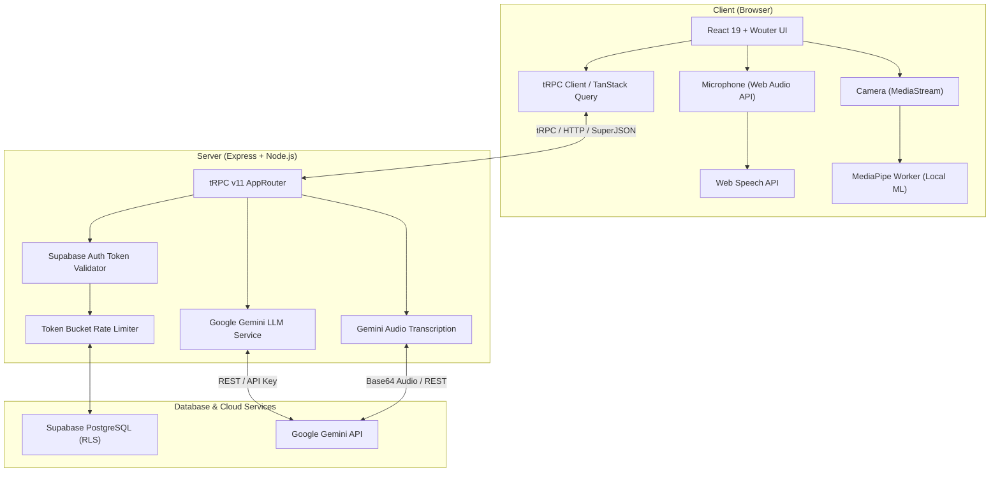

# Smart AI Interview — Full Project Architecture & Directory Structure

## 1. High-Level Architecture Overview

Smart AI Interview is a full-stack, enterprise-grade mock interview and behavioral coaching platform. It integrates:
- **Frontend:** React 19, TypeScript, Vite, Tailwind CSS, Radix UI primitives, Lucide icons, and Wouter for lightweight, hash-free client-side routing.
- **API & RPC Layer:** tRPC v11 with SuperJSON serialization and Zod input validation over Express 4.
- **Persistence & Security:** Supabase PostgreSQL with PostgREST, Row Level Security (RLS), and database-level token-bucket rate limiters.
- **AI & Speech Services:**
  - Google Gemini 2.5 Flash / Flash-Lite for structured question generation, rubric scoring, and adaptive interview turns.
  - Server-side Gemini Audio Transcription for high-fidelity audio buffer speech-to-text.
  - Client-side Web Speech API (`SpeechRecognition`) for real-time live preview.
  - Client-side MediaPipe vision tasks (Face, Pose, Hand Landmarkers) for local privacy-preserving behavioral analysis.



---

## 2. Directory Tree & Functional Breakdown

```
interviewai/
├── client/                              # Frontend React application
│   ├── public/                          # Static assets and favicon
│   └── src/                             # Client source code
│       ├── assets/                      # Bundled images, icons, and media
│       ├── components/                  # Shared React component library
│       │   ├── app/                     # Application shell and global layout
│       │   │   ├── AppShell.tsx         # Responsive sidebar, navigation, theme toggle
│       │   │   └── Shared.tsx           # PageHeading, Panel, Tag, Stat, EmptyState, LoadingState
│       │   ├── ui/                      # Primitive accessible UI components (Radix UI)
│       │   ├── AIChatBox.tsx            # Floating AI assistant / chat widget
│       │   └── ErrorBoundary.tsx        # React boundary catching runtime render exceptions
│       ├── contexts/                    # Global React Context providers
│       │   ├── SupabaseAuthContext.tsx  # User session, auth state, sign-in/sign-out
│       │   └── ThemeContext.tsx         # Dark / Light theme management and persistence
│       ├── data/                        # Static metadata, roles, and course catalogs
│       ├── features/                    # Feature-specific interview modules
│       │   ├── behavioral-interview/    # Observable behavioral practice module
│       │   │   ├── BehavioralInterviewPages.tsx  # Setup, live room, and report pages
│       │   │   ├── behavioral.worker.ts          # Off-thread MediaPipe vision worker
│       │   │   └── device-state.ts               # Camera and microphone selection utilities
│       │   └── live-interview/          # Real-time adaptive live interview module
│       │       ├── LiveInterviewPages.tsx        # 3-panel live room, webcam preview, audio visualizer
│       │       └── live-interview.css            # Specialized live interview animations and styling
│       ├── hooks/                       # Reusable React custom hooks
│       ├── lib/                         # Client utility libraries & query clients
│       │   ├── auth-redirect.ts         # Post-login and onboarding routing logic
│       │   ├── interview-completion.ts  # Session finalization triggers and leases
│       │   ├── notifications.ts         # Global in-app toast notification helpers
│       │   ├── safeStorage.ts           # Safe localStorage / sessionStorage wrappers
│       │   ├── scoring.ts               # Client-side score normalization helpers
│       │   ├── supabase.ts              # Supabase browser client initialization
│       │   ├── trpc.ts                  # tRPC React Query client hooks
│       │   └── utils.ts                 # ClassName merge (`cn`) and UI utility functions
│       ├── pages/                       # Top-level route pages
│       │   ├── AccountPages.tsx         # User settings, profile, and admin controls
│       │   ├── AnalyticsPages.tsx       # Performance analytics, skill gap, history, bookmarks
│       │   ├── AuthPage.tsx             # Sign in, registration, and password recovery
│       │   ├── Home.tsx                 # Landing page with interactive feature overview
│       │   ├── InterviewPages.tsx       # Standard Practice Interview flow and reports
│       │   ├── Onboarding.tsx           # Initial user profile and role setup wizard
│       │   ├── PreparePages.tsx         # Question bank browser, resume upload, study planner
│       │   ├── ProjectInsightsPage.tsx  # Engineering metrics and architectural telemetry
│       │   └── ProjectStatusPage.tsx    # Implementation progress and feature milestone status
│       ├── types/                       # Client-specific TypeScript interfaces
│       ├── App.tsx                      # Root route configuration and code-splitting
│       ├── index.css                    # Global base styles and Tailwind directives
│       ├── main.tsx                     # React 19 application entry point
│       └── theme.css                    # App theme color tokens and dark mode styling
├── server/                              # Backend Express & tRPC application
│   ├── _core/                           # Foundational server infrastructure
│   │   ├── context.ts                   # tRPC context building (extracts Supabase token & user)
│   │   ├── database.ts                  # PostgREST REST client & PostgreSQL connection pool
│   │   ├── gemini-rate-limit.ts         # Shared database token-bucket limiter
│   │   ├── index.ts                     # Express server startup, body parsers, Vite integration
│   │   ├── llm.ts                       # Google Gemini structured generation & completions
│   │   ├── request-limits.ts            # HTTP request body size boundaries
│   │   ├── runtime-config.ts            # Server environment configuration validator
│   │   ├── systemRouter.ts              # Health check (`/api/health`) and system notifications
│   │   ├── trpc.ts                      # tRPC router instantiation & procedure definitions
│   │   ├── vite.ts                      # Vite dev server middleware and production static serving
│   │   └── voiceTranscription.ts        # Server-side Gemini audio transcription service
│   ├── ai.ts                            # AI question generation, rubric scoring, and study plans
│   ├── behavioral.ts                    # Behavioral interview session CRUD & observation persistence
│   ├── finalization-lease.ts            # Atomic concurrency lease manager for session finalization
│   ├── live-interview.ts                # Live interview session lifecycle and adaptive question generation
│   ├── routers.ts                       # Central tRPC `appRouter` aggregating all API procedures
│   ├── scheduled-work.ts                # Background maintenance, question refresh, stale session cleanup
│   └── scheduled-work-adapters.ts       # External scheduler integration adapters
├── shared/                              # Shared universal code (Browser & Node.js)
│   ├── _core/                           # Common core error definitions
│   ├── behavioral-scoring.ts            # Observation aggregation, gaze, pose, and face heuristics
│   ├── const.ts                         # System limits, audio constraints, and supported MIME types
│   ├── scoring.ts                       # Rubric normalization math and silence hallucination checks
│   └── types.ts                         # Universal TypeScript definitions and DTO schemas
├── supabase/                            # Supabase database configuration & migrations
│   └── migrations/                      # 13 ordered, idempotent SQL migrations
│       ├── 202611010001_core_schema.sql
│       ├── 202611020001_interview_sessions.sql
│       ├── 202611030001_behavioral_atomic_lifecycle.sql
│       ├── 202611040001_live_interview_schema.sql
│       └── 202611100001_gemini_rate_limits.sql
├── docs/                                # Technical specifications and documentation
│   ├── mediapipe-web-implementation.md  # Client-side ML architecture and pipeline
│   └── PROJECT_STRUCTURE.md             # Complete system architecture and guide (this document)
├── scripts/                             # Utility and administrative scripts
│   └── migrate-supabase.ts              # Controlled migration runner using database URI
├── package.json                         # Dependencies and npm scripts
├── tsconfig.json                        # TypeScript strict compiler configuration
├── vite.config.ts                       # Vite client build configuration
└── vitest.config.ts                     # Vitest unit and integration test configuration
```

---

## 3. Core Feature Workflows

### 3.1 Live Interview Workflow (`/live-interview/:id`)
1. **Lobby & Initialization:** User selects role, duration, and target language. Session is created in `live_interview_sessions` in `in_progress` state.
2. **Audio/Video Ingestion:** Browser initiates `MediaStream` with active audio track. Web Audio API visualizer animates live mic volume.
3. **Adaptive Question Delivery:** AI Interviewer asks questions sequentially. Audio can be repeated via browser Web Speech synthesis.
4. **Answer Capture & Sync:**
   - Web Speech API (`continuous = true`, `interimResults = true`) streams live text into the draft preview and editable textarea.
   - User can pause, resume recording, edit typed text, or speak again.
   - `MediaRecorder` runs in parallel; if real-time speech recognition fails or is incomplete, audio buffer is transcribed server-side via Gemini STT.
5. **Adaptive Evaluation:** Turn evaluation executes via Gemini API using the standardized scoring rubric.
6. **Finalization & Lease Recovery:** Upon deadline or user completion, atomic finalization lease (`finalization-lease.ts`) ensures the report is generated without duplicate evaluation runs or stale locks.

### 3.2 Behavioral Interview Workflow (`/behavioral-interview/:id`)
1. **Question Generation:** Role-specific behavioral questions are generated from topic, difficulty, and skills.
2. **Setup & Optional Camera:** Microphone is verified; camera permission is optional. If enabled, camera video stays strictly local and is processed off-thread in `behavioral.worker.ts` via MediaPipe.
3. **Dual Input Answering:**
   - Spoken answers are captured via microphone with real-time SpeechRecognition and audio level meter.
   - Users can edit the transcription directly or type answers completely by hand.
4. **Observation Aggregation:** Facial landmark events (e.g. looking away, additional visible face) and vocal metrics are synthesized into coaching observations without punitive scoring.
5. **Report Generation:** Generates comprehensive observable evidence report with coverage and reliability scores.

### 3.3 Practice Interview & Coaching Workflow (`/practice`)
1. **Course & Role Setup:** Target role, difficulty, and context are configured.
2. **Structured Rubric Evaluation:** Answers are scored across Content Relevance, Technical Accuracy, Structure/Clarity, and Problem Solving.
3. **Silence Hallucination Protection:** Answers are checked against `isSilenceHallucination()` before scoring to prevent zero-score penalties from noisy background audio.

---

## 4. Security & Compliance Principles

1. **Zero Raw Audio Retention:** Recorded audio buffers are held strictly in-memory during transcription and discarded immediately after processing.
2. **Local Visual ML:** MediaPipe face, pose, and hand detection runs 100% in the client browser inside dedicated Web Workers. Video frames and landmark coordinates are never transmitted to any server.
3. **Row-Level Security (RLS):** All Supabase database tables enforce RLS ensuring users can only read and write their own sessions, turns, and answers.
4. **Server-Side AI Credential Isolation:** The Google Gemini API key is isolated to the Node.js server. The client never receives or stores the API key.
5. **Shared Rate Limiting:** A database-backed PostgreSQL token bucket (`gemini_rate_limit_state`) protects against API quota exhaustion across distributed instances.

---

## 5. Development & Verification Commands

- `pnpm dev` — Start the full-stack development environment (Express server + Vite client).
- `pnpm check` — Run strict TypeScript type checks across client, server, and shared directories.
- `pnpm lint` — Run ESLint across all TypeScript and React components.
- `pnpm test` — Run all Vitest unit, contract, and integration test suites.
- `pnpm build` — Build production Vite client bundle and bundled Node.js server (`dist/index.js`).
- `pnpm start` — Run the production-built application.
